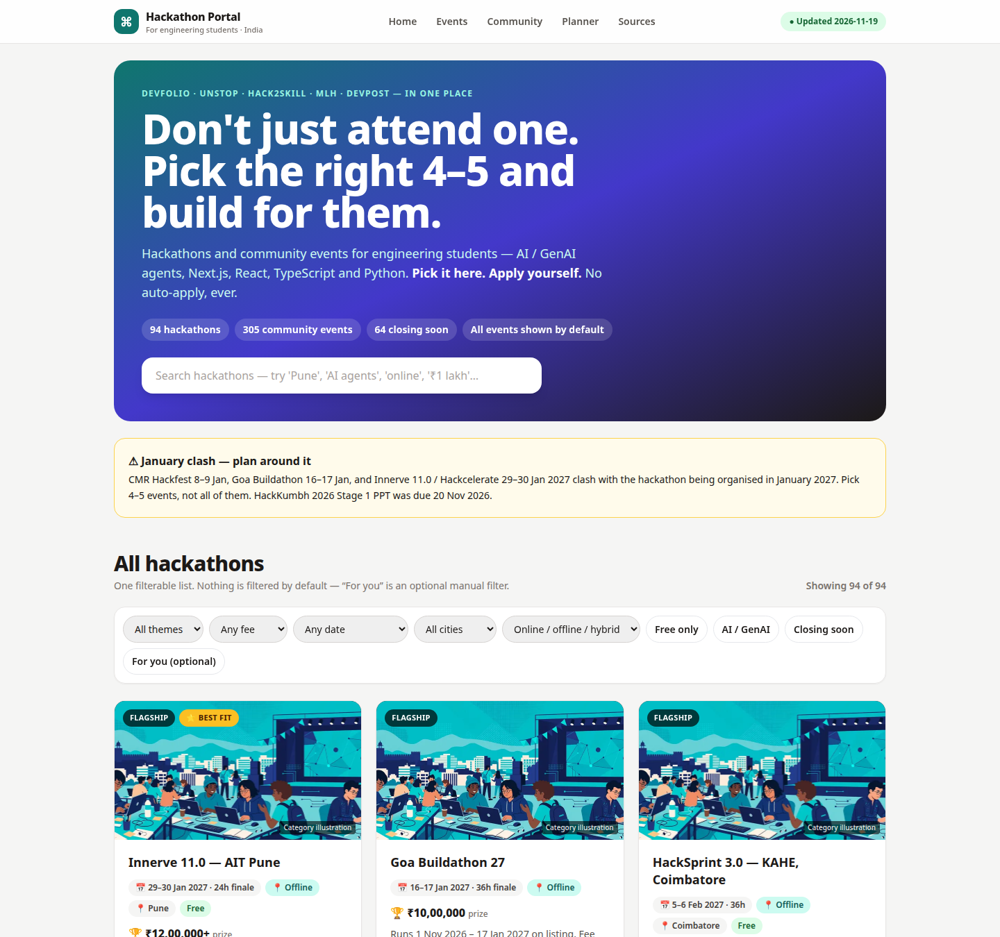

# Hackathon Portal — Hackathons & Community Events for Engineering Students

> **Find the right hackathon. Pick it here. Apply yourself.**
> An open-source portal listing hackathons and community/startup events for engineering students and developers in India — updated daily.



Built by [Pranav Shinde](https://github.com/Iampranav009) · Open source (MIT) · Next.js 14 + TypeScript + Tailwind CSS

## About

**Hackathon Portal** brings together, in one place, the hackathons and community events that matter to an engineering student in India — instead of checking Unstop, Devfolio, Hack2Skill, MLH, Devpost and HackerEarth separately every day.

It is for **engineering students and developers** — especially those building with AI / GenAI agents, Next.js, React, TypeScript and Python — who want to find events they can actually join, compare dates, deadlines, fees and prizes, and plan which 4–5 events to build for, instead of missing deadlines.

**At launch (last scanned 19 Nov 2026):**

| What | Count |
|---|---|
| Hackathons | **94** (76 open, 8 closed, 10 unconfirmed) |
| Community / startup events | **305** — Bengaluru 124, Delhi/NCR 60, Mumbai 46, Online/Other 38, Pune 21, Chennai 16 |
| Watch-list items (unconfirmed) | **59** |
| Best-fit events (AI agents / Next.js / free / student-eligible) | **14** hackathons |

**Latest sync (last scanned 21 Nov 2026):**

| What | Count |
|---|---|
| Hackathons | **224** (106 open, 10 closed, 108 unconfirmed — includes Pixelforge, added by the Devpost auto-update, not on the Muse page) |
| Community / startup events | **334** — Bengaluru 135, Delhi/NCR 67, Mumbai 49, Online/Other 44, Pune 22, Chennai 17 |
| Watch-list items (unconfirmed) | **59** |
| Best-fit events | **34** hackathons |
| Must Attend (see `/must-attend`) | **59** — 25 hackathons + 34 community events |

Every event carries its date, city/mode, deadline, fee, prize and official link where verified. Unknown fields are `null` / "TBA" / "Unconfirmed" — **nothing is invented**. 18 hackathon cards use the organiser's official banner; the rest use a category illustration, labelled on the card (see [`docs/BANNERS.md`](docs/BANNERS.md)).

There is **no auto-apply** anywhere on this site. You pick an event here and apply yourself on the official page.

## Features

- **Search** — search by title, city, theme or prize ("Pune", "AI agents", "online", "₹1 lakh"…)
- **Filters, with no default filter** — theme, fee, timing, city, online / offline / hybrid, Free only, AI / GenAI, Closing soon, and an optional "For you" filter. All events are shown by default; nothing is pre-selected.
- **Closing-soon Planner** — open events ordered by deadline, so you know what to do first.
- **Community events by city** — meetups, pitch days, demo days and dev festivals (not hackathons), grouped by Bengaluru, Pune, Mumbai, Delhi/NCR, Chennai and Online/Other.
- **Best-fit badges** — events matching an AI-agents / Next.js / React / TypeScript / Python, free-or-low-cost, student-eligible profile are starred.
- **Real event covers** — 18 official organiser banners stored locally in `public/banners/`; every other card uses a category illustration, clearly labelled "Category illustration" vs "Official banner".
- **January-clash alert** — flags when big January 2027 events clash with each other, so you can plan around them.
- **Mobile-first, dark-mode friendly** — sticky header on desktop, bottom navigation on mobile.
- **Watch-list** — unconfirmed aggregator mentions, kept separate from verified events.

## Data sources

Events are gathered from the organiser / platform listings themselves:

- [Unstop](https://unstop.com) · [Devfolio](https://devfolio.co) · [Hack2Skill](https://hack2skill.com) · [MLH](https://mlh.io) (public listings only) · [Devpost](https://devpost.com) · [HackerEarth](https://www.hackerearth.com)

This site is a **dated snapshot, not a live scraper** — it does not fetch live listings when you open it. It is refreshed by the daily update process below, and the last-scanned date is shown in the header.

## How updates work — daily, two tracks

### Track A — automatic (GitHub Action, public sources only)

A GitHub Action (`.github/workflows/daily-update.yml`) runs daily at 03:00 UTC (**08:30 IST**) and runs `scripts/update-events.mjs`. It fetches Devpost's public hackathons listing page (no login, no API key — Devpost has no public hackathons RSS feed, so the script reads the page's embedded JSON-LD event list), adds only *new* India-relevant events, dedupes by title + link, and **never overwrites a manually verified field with a blank** — existing entries are left untouched. If the JSON changed, the Action commits and pushes it, and Vercel redeploys automatically. The Action needs **no secrets**.

Run it locally any time:

```bash
npm run update-events
```

### Track B — daily scan (login / JS-protected sources)

Unstop, Devfolio and Hack2Skill are login- or JS-protected, so the script above deliberately does **not** attempt their logins. New listings from those platforms come from a daily scan, which verifies date, mode/city, eligibility, fee, deadline and official link. To update:

1. Edit `data/events.json` / `data/community.json` — add one object per event, using the same schema (see `docs/ARCHITECTURE.md`).
2. Commit + push. Vercel redeploys automatically.

**Rule: never invent an event, date, prize or link.** If a field is unknown, leave it `null` / `"TBA"` / `"Unconfirmed"`.

## How it works — JSON is the database (v1)

There is **no database server** in v1, on purpose. The data lives in version-controlled JSON files, and that *is* the database:

- `data/events.json` — hackathons (94 at launch, last scanned 19 Nov 2026)
- `data/community.json` — community / startup events, grouped by `city` (305 at launch)
- `data/watchlist.json` — 59 unconfirmed aggregator mentions (compact list, not full cards)
- `public/banners/` — event cover images: 18 official organiser banners + 4 category illustrations for the other cards. See [`docs/BANNERS.md`](docs/BANNERS.md) — no banner URL was invented.

This is free, fast, and editable by anyone with a pull request. See [`docs/ARCHITECTURE.md`](docs/ARCHITECTURE.md) for the full design and for the future Supabase migration path (the JSON schema already maps 1:1 to a Postgres table — no Supabase code is included yet, by design).

## Tech stack

- **Next.js 14** (App Router, static export-friendly) + **React 18**
- **TypeScript**
- **Tailwind CSS**
- **JSON data** — no backend, no database, no API keys, no environment variables
- **GitHub Actions** — daily auto-update, no secrets
- **Vercel** — free Hobby hosting, automatic redeploy on every push

## Run locally

```bash
npm install
npm run dev
```

Open http://localhost:3000

## Deploy on Vercel (free)

1. Push this repo to GitHub.
2. In [Vercel](https://vercel.com), **Add New → Project → Import** the GitHub repo.
3. Leave the defaults (Framework: Next.js, no build settings to change).
4. **No environment variables are needed.** Deploy.

Vercel Hobby is **free** for this site, and **no paid API is needed** — the site is static data from the JSON files; there is no backend, no database bill, and no API key anywhere.

Every push to the main branch redeploys automatically.

## Connect a custom domain

1. Buy a domain (about ₹800–1,000/year from any registrar) — or use one you already own.
2. In Vercel: Project → **Settings → Domains → Add** your domain (e.g. `hackathons.yourdomain.com`).
3. Vercel shows you the DNS record to add at your registrar (a `CNAME` for a subdomain, or an `A` record for an apex domain).
4. Add that record, wait a few minutes, and Vercel issues a free HTTPS certificate automatically.

## Contribute

Anyone can add an event:

1. Fork this repo.
2. Add the event to `data/events.json` (hackathon) or `data/community.json` (meetup / pitch day / demo day), following the existing schema — include the official link and mark `verified: false` unless you checked the organiser's own page.
3. Open a pull request with the event name and source link in the description.

Please do not add events with invented dates, prizes or links, and do not add auto-apply or any sign-in / application flow — this portal lists events; visitors apply themselves on the official site.

To add a real event banner, see [`docs/BANNERS.md`](docs/BANNERS.md): only use a banner you can verify on the organiser's own page, save it under `public/banners/<event-slug>.webp` (max 1200px wide), and set the event's `banner` / `bannerSource: "official"` fields.

## Project structure

```
app/            Next.js App Router — layout.tsx, page.tsx, globals.css
data/           events.json, community.json, watchlist.json  (the database)
lib/events.ts   Types + JSON loading + closing-soon helper
public/         banners/ (official banners + category illustrations), screenshot.png
scripts/        update-events.mjs  (public-sources daily update, no login)
.github/        workflows/daily-update.yml  (daily 08:30 IST, no secrets)
docs/           ARCHITECTURE.md  (JSON-first design + Supabase migration path)
                BANNERS.md       (official banners vs category placeholders)
```

## License

MIT — see [LICENSE](LICENSE). Copyright © 2026 Pranav Shinde.
